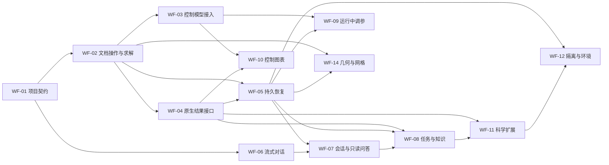

# 全工作流交付方案与验收标准

更新：2026-10-08。规划基线：根 `15297a9`，AI 子模块 `21bbdc1`。本文定义后续开发范围、接口方向和验收条款；任务状态、依赖和证据索引的唯一来源是 [workflow_delivery_plan.json](workflow_delivery_plan.json)。WF-01 已验收，WF-02 正在实施；后续任务仍须分别交付和验收。条款描述目标范围，当前产品能力以运行时 capability/schema、已交付操作手册及任务证据为准。

## 读取入口与文档分工

1. [DEVELOPMENT_PLAN.md](DEVELOPMENT_PLAN.md)：总体阶段、当前基线与本轮执行入口。
2. 本文：每个 WF 任务的设计、边界和验收条款。
3. [workflow_delivery_plan.json](workflow_delivery_plan.json)：机器可读状态、依赖、代码范围和证据；通过 `scripts/ci/verify_workflow_plan.py` 校验及选择下一项。
4. [开发 Agent 续作指南](agent_playbooks/workflow_delivery.md)：读取、选择、实施、验证、审查、提交及中断交接的操作步骤。
5. [WORKFLOW_CONTRACT.md](WORKFLOW_CONTRACT.md)：共同事务、权限与界面原则；[AGENT_OPERATIONS.md](AGENT_OPERATIONS.md)、[WORKFLOW_SDK.md](WORKFLOW_SDK.md)、[EXTENSION_SDK.md](EXTENSION_SDK.md)：当前产品可调用范围。

本文与续作指南服务于仓库开发 Agent。产品内的大模型以已安装的操作知识和运行时 capability/schema 为准；开发计划不能给产品 Agent 增加 shell、文件读取、批准或未实现 RPC 权限。新功能交付时更新操作手册与随包知识，本次不把开发流程注入产品工具目录。

## 基线、缺口与完成声明

已验收基线有三条受限路径：GUI 模态配置/Undo/Redo；独立四杆/平面梁工作区的实际 FE 控制、续算及曲线；受信开发者模式的 numeric-series-statistics v1 扩展。私有 CPython/NumPy/SciPy 已打包。证据见 [GUI_UX_ACCEPTANCE.md](GUI_UX_ACCEPTANCE.md) 与 [STAGE12_ACCEPTANCE.md](STAGE12_ACCEPTANCE.md)。107 项全回归是 2026-10-04 的记录，最后显示修正另有针对性回归；不得复用为后续新代码验收。

| 缺口 | 对应任务 |
| --- | --- |
| 当前文档、项目、控制工作区身份未贯通 | WF-01、WF-03 |
| 命令/上下文覆盖少，普通文档求解和结果未进入 Agent 工具链 | WF-02、WF-04 |
| 几何/网格写入口及重网格后的映射失效未迁入命令链 | WF-14 |
| 草稿/保存状态、未知操作结果、中断检查点恢复 | WF-01、WF-05 |
| 流式回答、会话分支、并行只读问答和长任务计划 | WF-06、WF-07、WF-08 |
| 运行中调参/暂停及多任务、长时曲线 | WF-09、WF-10 |
| 通用科学计算、声明式扩展界面与可信运行环境 | WF-11、WF-12 |
| 版本化操作知识与商业发布验证 | WF-08、WF-13 |

Stage 12 的受控 v1 已有交付证据；通用二次开发及完整产品工作流按本清单继续验收。研究扩展 R7/R8/R9、实物 H1 保留在总体计划中，不混入本清单的完成率。

## 执行顺序与工作量

WF-13 是所选完整交付范围的发布汇合门槛；其中 CI、性能、兼容和安装检查从每个 WF 开始执行。图中省略 WF-13 的汇合连线，完整依赖以 JSON 为准。

| 首选顺序 | 任务 | 相对工作量 | 可并行条件 |
| --- | --- | --- | --- |
| 1 | WF-01 | S | 固定身份、契约及测试夹具；其他任务先做只读准备 |
| 2 | WF-02 → WF-04 → WF-05 | L / M / XL | WF-03 可在 WF-02 后启动；文件与接口所有权需明确 |
| 同步体验线 | WF-06 → WF-07 | M / L | WF-06 在 WF-01 后可开始；WF-07 等持久恢复基础 |
| 3 | WF-08、WF-09、WF-10、WF-14 | L / XL / L / XL | 各自依赖满足且不同时编辑相同 GUI/runner 文件 |
| 4 | WF-11 → WF-12 | XL / XL | 受信科学扩展先交付；普通模式启用等待隔离反例验证 |
| 全程/终验 | WF-13 | L，持续 | 不以末尾才补质量线；最终范围所有必需条款齐全 |

S/M/L/XL 是复杂度与验证成本的相对量级，不是人天或日历承诺。第一次代表模型/性能测量后，可在任务记录中补工时估算、假设和实际耗时。每个 WF 可拆成多个稳定提交，保留未完成条款；不要为满足阶段号一次更改整个求解器。

## 共同接口与状态约定

以下为目标契约，首先由 WF-01 固定 schema 和版本：

- `projectId` 表示工作区项目，新增 `persistentDocumentId` 表示持久文档。保留现有 `range.host/v1` 的 `documentId/sessionEpoch/documentRevision` 作为运行期实例引用，不改写其生命周期含义；项目目录提供持久 ID 到当前运行期引用的映射，重新打开时旧实例/批准失效。新增 `sourceRevision/modelSha256` 描述接受快照。
- `operationId` 关联一次受批准操作；`jobId/runId` 关联计算；`artifactId/sha256` 关联不可变工件。GUI 列表位置、文件路径和对象指针不能替代身份。复制/另存为的身份规则有明确测试。
- 人可读的文档/实体标签仅用于展示与检索，不作为修改身份。目标查询返回实体类型、稳定 ID、标签、所属文档及版本；重名/模糊匹配返回候选或歧义，不自动选择。现有 host 只提供部分数值 entity/group ID，标签与解析接口属于 WF-02 待交付能力。
- 请求包含接口/命令版本、请求 ID、目标/来源版本、规范参数及幂等键。批准由宿主绑定规范参数、目标版本、执行范围及有效期；模型不能自批，历史摘要不能携带新授权。
- 编辑接受、作业成功、结果验证通过分别是 `accepted`、`succeeded`、`validationPassed`；发布位置及 `memory_only/checkpointed` 单独报告。失败、冲突、未知结果、待恢复不能统一显示“完成”。
- 查询与命令共用 schema/验证规则，GUI/CLI/SDK/Agent 是薄适配。追加操作先通过 capability 发布；更改旧字段语义需新版本或显式兼容层，旧客户端对未知类型明确拒绝。
- 标量/向量结果携带物理单位、坐标系、稳定节点/单元/通道 ID、有效性、时间网格与来源。`native-fe`、`independent-reference`、`caller-supplied` 分别标识，不互相替代。新结果契约不静默改写现有 `native-accepted-control` 遥测协议。
- 执行目标接口按 `context/query → validate → preview → host approval → execute → inspect → verify` 组织。计划名称如 `document.snapshot.create`、`analysis.run`、`result.series.query`、`control.parameters.preview` 仅为待实现接口方向，最终名称由 WF-01 schema 固定并在能力目录公布。
- 首版项目元数据继续采用有界、版本化、原子替换的 JSON，复用既有工作区存储。项目索引、模型文件、结果与审计是不同提交边界，通过发布意图/观察核对恢复。若改用数据库，先记录迁移 ADR、数据规模依据及失败语义，再实施；数据库不能替模型文件提供跨文件原子性。

目标工作区布局：`project.json` 为身份和索引；`models/<persistentDocumentId>/snapshots/<sha256>/` 为模型快照；`jobs/<jobId>/` 保留既有任务工件；`operations/` 为持久操作/发布记录；`conversations/` 为脱敏会话；`extensions/` 保留不可变候选与版本。布局迁移需要 WF-05 兼容验证，不在规划提交时移动用户文件。

## 共同交付门槛与证据

每个验收 ID 都是必需条款。JSON 中 `done` 要求所有条款有通过证据且依赖已完成；`failed/skipped/unverified` 不算通过。外部条件不足时保留未完成条款和阻塞原因，继续独立可执行工作。

规划校验器验证结构、依赖、文档引用和证据元数据，不执行功能测试，不证明日志或提交的业务结论。代码提交、实际运行结果及独立审查仍需开发 Agent 核对。跨机器续作使用已提交的验收结论作为稳定证据索引，原始 `build/` 工件是否可取得另行标注。

每个增量按以下步骤收尾：

1. 记录改动范围、来源提交/子模块、实际命令、环境和输出位置；固定代表算例、物理量、门槛与允许能力。
2. 运行与风险对应的测试；有数值变化时比较独立参考、连续/分段和失败回滚。新增必跑目标同时加入 CMake 与 `required-ctest-tests.json`，不删除失败断言降低门槛。
3. 独立审查：身份/版本、批准与副作用、线程/取消、数据来源、磁盘恢复、兼容和缺测。按用户当前配置使用 Luna max；审查者不与实现者同时修改同一文件。
4. 修复审查确认的问题并做必要回归。接口/求解/生命周期的集成里程碑完成时执行全目标 Release、必跑清单与完整 CTest；只有局部显示/文档修正时用针对性检查，并注明完整回归的版本边界。
5. 更新当前功能手册/schema/知识及证据。先提交受影响子模块，再提交根集成；本地提交，不自动推送。实现、通过测试、可用入口、外部终验分别报告。

原始日志、临时脚本、截图和模型输出放忽略目录 `build/audit-YYYYMMDD/<taskId>/`。JSON 只索引证据，不嵌入日志正文、凭据或大工件；长久保留的结论进入主题验收文档。记录基线提交和证据所对应代码提交；不得因写了新规划而修改历史验收结论。

## WF-01 项目身份、快照与契约基础

依赖：无。范围：`Session`、`ModelCommandHost`、`WorkflowProcess`、工作区 service 和共享协议/schema。先固定跨入口数据契约，再增加写操作。

设计：引入持久项目/文档到工作区的显式关联，保留打开实例的 session stamp；模型快照与业务参数分别绑定哈希。草稿与未保存状态由 GUI 提交路径维护；尚不能识别的入口报告 `unknown` 并给出原因，不自动丢弃草稿。当前 capability 描述、目标契约和拒绝范围分别导出。

WF-01 首版生命周期规则固定如下；更改时先修改规则和反例，再实施：

| 操作 | 持久身份/来源 | 运行期引用与批准 |
| --- | --- | --- |
| 新建项目 / 重开项目 | 新建生成 projectId；重开保留 projectId | 重开生成新的会话引用，旧批准失效 |
| 新文档 / 导入未登记文件 | 新 persistentDocumentId；同字节或同名不合并身份 | 创建新运行期文档引用 |
| 关闭/重开已登记文档 | 保留 persistentDocumentId 与已保存来源索引 | 关闭使旧运行期引用失效；重开返回新引用 |
| 保存 / 原位重载 | 保留持久 ID；保存记录真实 savedArtifactHash；外部内容变化先报告来源冲突，再按重载路径接受新版本 | 相应 stamp/批准按内容或生命周期规则失效 |
| 另存为并替换当前保存目标 | 保留持久 ID，解除旧路径索引并登记新位置；之后重新导入旧文件得到新 ID | 保存目标改变使有关提案/发布绑定失效 |
| 保存副本 / 复制为新文档 | 新持久 ID，记录 origin 引用；允许共享不可变快照，编辑版本独立 | 新实例不继承原批准；原文档不变 |
| 改名 / 列表重排 | 仅改显示标签/顺序，不改身份 | 目标仍以固定 ID/版本解析，重名不自动选择 |
| 移除文档 | 记录 tombstone，ID 不复用；是否删除源文件是另一个显式操作 | 当前实例及待批准提案失效 |

- **WF-01-A01**：关闭/重开同一文档保留持久身份并更换实例；复制、另存为、删除、同名文档与列表重排按固定规则映射，无身份串用。
- **WF-01-A02**：修改、Undo/Redo、重载、保存分别更新应有版本/哈希；缓存、接受态、表单草稿与未保存状态互不冒充。
- **WF-01-A03**：GUI/CLI/SDK 查询同一已接受对象得到一致模型身份、单位和版本；未关联工作区不能声称代表当前文档。
- **WF-01-A04**：能力/schema 含版本、支持模型/单元/分析/单位、只读/写入与拒绝条件；未知版本/字段和不支持组合有明确诊断。
- **WF-01-A05**：快照创建期间并发修改、关闭与取消不会产生混合版本；已冻结快照不被后续编辑改变。
- **WF-01-A06**：旧 `range.host/v1`、模板工作区和模型格式保持可用或明确拒绝；不静默更改 session stamp 的含义。
- **WF-01-A07**：真实 Application/Session 与进程服务的身份/草稿/快照反例测试通过，文档和 schema 示例可由同一解析器验证。

首个验收故事：打开现有支持的梁模型 → 编辑尚未提交参数 → Agent 查询到草稿状态 → 用户提交 → 快照版本一致 → 关闭/重开后仍能定位来源。

## WF-02 原生文档上下文、命令与求解入口

依赖：WF-01。范围：`model_command_host.*`、`session.*`、`solver_task.*`、`solver_manager.*`、分析配置控件和应用服务。

分批迁移：先分析配置/求解/取消/结果定位，再材料与边界/载荷；几何/网格写入口拆到 WF-14，避免在本任务首批验收后失去跟踪。每一批明确可用实体与参数；不把任意 QWidget/C++ 方法暴露给模型。普通 SolverTask 继续使用已冻结输入和独立目录，Agent 与手工按钮共用验证/提交路径。

- **WF-02-A01**：上下文返回当前分析、已接受材料/边界/载荷/控制配置和能力可见性；目标查询返回类型/稳定 ID/标签/所属版本，大型数据有界分页，未知数据不补默认值。
- **WF-02-A02**：分析、材料、边界/载荷三类首批操作完成验证/预览/执行接线；同名/改名/模糊标签、列表重排与过期选择不能改错对象，非法字段、单位、目标及版本保持原模型不变。
- **WF-02-A03**：GUI/CLI/SDK/Agent 对同一支持操作产生一致候选、接受结果和诊断；手工旧入口纳入修改通知，未纳入的写入口不向 Agent 开放。
- **WF-02-A04**：Agent 能提交当前文档的原生求解并获取真实 jobId/来源快照、进度、取消与终态；重复执行同一操作不启动第二个作业。
- **WF-02-A05**：A 版求解时可编辑 B 版及另一文档；A 结果不覆盖 B，关闭/取消后的结果只以明确来源保留。
- **WF-02-A06**：编辑命令进入 Undo 分组；求解、取消、结果文件发布与编辑撤销的语义分别显示，不删除已完成结果冒充撤销计算。
- **WF-02-A07**：真实窗口覆盖预览冲突、批准失效、运行中编辑、草稿/焦点保留、关闭/取消竞态；只允许已验证的线程归属和 queued 接线。
- **WF-02-A08**：每一批都有能力覆盖矩阵和独立基准/业务检查，完成原生求解→结果定位故事；全目标/完整必跑回归及独立审查通过。

完成范围为支持矩阵内的三类首批操作与求解入口；新增任意单元、约束或分析算法仍单列验收。

## WF-03 当前模型接入受限控制工作流

依赖：WF-02。范围：`WorkflowWidget/WorkflowProcess`、`jobs.py/templates.py`、原生 workflow 适配器、模型控制/传感器目录。

设计：增加显式“使用当前文档快照”入口，保留模板入口。首批只覆盖已有验证对应的共线杆和单平面 BEAM1 动力路径。编码前冻结可机检导入矩阵：单元/拓扑、活动 DOF、约束/支承、材料/截面、算法/阻尼/初值、传感器/执行器与参考生成条件；每项列支持值、拒绝值和夹具。第一批可先要求与已验收拓扑相符，扩大拓扑时另添独立参考；不宣称任意网格可导入。控制矩阵由该快照产生，不沿用模板文件的硬编码模型参数。

- **WF-03-A01**：同一快照在 GUI、工作区配置、原生计算和结果中携带相同 persistentDocumentId/sourceRevision/modelSha256，并保留来源运行期引用；输入文件不可由另一文档替换。
- **WF-03-A02**：支持模型可导入；超出单元、拓扑、约束、坐标或算法范围的模型在提交前被拒绝并定位原因，不回退为模板求解。
- **WF-03-A03**：传感器/执行器节点、DOF、全局方向、力/力矩及单位映射可预览；局部 DOF 标签不得代替全局物理轴。
- **WF-03-A04**：修改支持模型的材料/几何/初值后，分析与控制数据确由新快照产生；使用独立参考重新验证，不沿用旧模板误差报告。
- **WF-03-A05**：实际原生主动/被动路径及分段续算与同输入连续轨迹一致；位移、速度、转角、角速度分别使用既定单位门槛。
- **WF-03-A06**：求解期间修改/关闭来源文档不改变输入；显示来源版本、过期结果和当前编辑版，用户可打开独立结果。
- **WF-03-A07**：模型/映射/控制器/源工件篡改、重复批准、取消及失败不发布成功结果；旧模板路径回归通过。
- **WF-03-A08**：真实 GUI 打开支持的非默认文档快照→配置控制→批准→运行→查看原生曲线，SDK 同输入复跑和独立审查通过。

## WF-04 原生结果与统一时程接口

依赖：WF-02。范围：原生文档结果目录、`WorkflowWidget/ModelCommandHost`、工作区查询/遥测、扩展来源适配。

设计：提供按 artifactId 查询的结果目录、通道目录、分页时程和摘要。原生结果、独立参考及调用方数据均保留 sourceKind；模态/频域/时域结果通过显式类型区分。当前扩展读取 reference.json 的路径保留兼容，新增原生来源不借用该标签。

- **WF-04-A01**：每个结果绑定成功任务、模型/控制器/运行环境哈希、来源版本及验证范围；Agent 可读取普通文档求解工件而非只查询模板工作区。
- **WF-04-A02**：通道/时程包含稳定 ID、单位、坐标/方向、时间网格和有效性；缺失量明确不可用，位移/转角或力/力矩不混轴。
- **WF-04-A03**：分页/游标、部分尾部、序列缺口、重连、任务切换和数值边界有反例；查询不会修改任务或越界读取任意文件。
- **WF-04-A04**：原生主动、原生被动、独立参考和调用方数据来源可查询且可见；结果比较必须检查模型、时间网格、单位和可比通道。
- **WF-04-A05**：扩展能从哈希绑定的实际原生时程获得输入，支持已固定版本工件；源被篡改/未完成/来源不匹配时拒绝运行。
- **WF-04-A06**：表格、图表、CSV 和 Agent 总结引用同一结果数据；宿主可按 artifactId/稳定目标选择、定位、显示原生结果场，不能暴露任意 Qt 方法；冻结导出固定来源与范围。
- **WF-04-A07**：使用真实 FE 原生输出与独立参考核对；统计扩展从原生时程计算结果和宿主独立计算一致，不能以参考回放代替此用例。
- **WF-04-A08**：旧结果/API 可读或有明确迁移/拒绝诊断；安装 SDK 可复现结果读取→原生时程统计→GUI 展示闭环。

## WF-05 持久操作、发布核对与检查点恢复

依赖：WF-02、WF-04。范围：Session/命令宿主的操作账本、应用服务 journal、工作区状态、原生求解检查点和恢复 UI。

设计分三步：先持久识别未知命令/发布结果；再恢复项目/会话索引；最后从周期性接受检查点继续中断计算。复用现有 CLI 发布意图和工作区原子状态经验，补 GUI 生命周期边界。检查点必须完整保存积分器、控制器接受状态、参数版本和来源，不能仅凭日志里有 time/step 就续算。

首版恢复策略固定为最多间隔 10 个接受步或 1 s 仿真时间（先到者），允许回放损失不超过该范围；这是待实现验收目标，当前工作流仅在输出/终态边界序列化，不能据内存接受态宣称达到此值。磁盘检查点落后超限时等待或明确失败，不静默跳过。更大间隔须通过新的范围/性能决策记录。`mode=both` 按 active/passive 分别记录完成情况、检查点和来源；恢复只复用已校验部分，整体成功须两条轨迹及比较校核齐全。原始执行尝试日志保留，逻辑结果时程按来源/步号去重并标记回放区间。

- **WF-05-A01**：请求/候选/批准/提交/工件发布/观察核对有持久关联；批准令牌和密钥不入库。跨进程重复操作先核对原结果，不再次产生副作用。
- **WF-05-A02**：分别在意图前后、模型提交前后、工件发布前后和终态记账前后强制退出；额外覆盖 both 模式 active 完成/passive 未开始及 passive 进行中的中断，恢复报告真实状态，不把一条完成当整体成功。
- **WF-05-A03**：项目重开保留文档/作业/工件关联与已保存状态；未保存修改按声明策略恢复或明确指出未保护范围；旧批准在新实例失效。
- **WF-05-A04**：GUI 保存/多文件发布的部分成功可核对，不假称原子回滚；关闭补记失败有可再次处理的持久队列和用户诊断。
- **WF-05-A05**：原生周期检查点只含完整接受态，带校验、版本、model/control/runtime 哈希、acceptedSeq 和检查点策略；实测持久间隔/可丢失回放范围满足 10 步或 1 s 仿真时间先到者，损坏/截断/不匹配拒绝。
- **WF-05-A06**：`interrupted` 任务有实际恢复资格查询、选择和续作入口；无有效检查点时保持需重算状态，不把中断任务直接改为成功。
- **WF-05-A07**：中断后恢复的 q/v/a、控制器状态、功账和最终结果与连续计算在固定分单位门槛内一致；单轨及 both 部分恢复均验证，逻辑终态/结果步不重复，原始尝试记录与回放标记保留。
- **WF-05-A08**：协作锁冲突、目标被外部改写、磁盘写失败、坏日志和旧格式有故障注入；恢复不覆盖用户的新内容，不吞掉已发布工件。
- **WF-05-A09**：恢复 UI 和 Agent 查询明确区分“可恢复/需重算/待核对/冲突”，后台仍响应其他文档操作和取消。
- **WF-05-A10**：旧工作区迁移和回退策略、恢复操作手册、跨进程黑箱测试、完整集成回归及独立审查通过。

## WF-06 流式回答与工具活动界面

依赖：WF-01。范围：`AgentWidget`、AI 供应商适配、runner 消息/活动接口；不更改已有批准与任务接替语义。

设计：先为当前 DeepSeek/兼容 Chat Completions 提供有界 SSE 解析；文本可增量显示，工具调用参数只在完整且验证后交给 runner。工具活动卡片显示读取、准备、待批准、执行和验证；思考协议数据不作为操作证据。

- **WF-06-A01**：逐字节/随机分块、UTF-8 边界、多事件、结束标记和工具参数分片得到相同完整回合；未完整工具参数从不执行。
- **WF-06-A02**：响应/事件/消息缓冲有上限；非法 JSON、过长行、断流、超时和重复结束只终止关联请求，不伪造成功。
- **WF-06-A03**：Stop、接替、关闭、旧请求迟到响应和同步信号重入保持任务代次隔离；已提交计算和已接受操作事实保留。
- **WF-06-A04**：增量渲染不丢草稿/焦点/选择；尊重用户滚动位置，只有跟随末尾时自动滚动；代码/列表/表格完成后排版正常。
- **WF-06-A05**：资源读取、链接、原始 HTML 及协议元数据不成为执行入口；凭据/HTTP 错误正文不进入聊天/导出/日志。
- **WF-06-A06**：活动与批准卡片关联唯一 task/tool/operation ID，模型文本不代替宿主接受或结果验证；拒绝不隐式重试。
- **WF-06-A07**：非流式兼容端点仍可完成回合；供应商能力不支持的 effort/参数明确禁用，当前任务固定配置快照。
- **WF-06-A08**：离线供应商夹具覆盖上述故障，真实控件回归通过；可用凭据下的真实供应商联调独立记录，完整产品供应商终验归 WF-13，缺凭据不伪装成真实测试。

## WF-07 会话持久化、分支与并行只读问答

依赖：WF-05、WF-06。范围：会话存储/索引、AgentWidget/runner、读写任务路由和宿主授权。

设计：持久会话保存脱敏消息、工具事实和来源引用，批准/待执行指针恢复时失效。提供明确的“追问当前任务”“只读提问”“接替任务”操作；只读问答不能获取编辑/批准/执行工具，来源版本在回答中可核对。写任务按项目/文档资源串行，计算任务依旧独立。

- **WF-07-A01**：关闭/重开后可恢复会话与已发生操作事实；恢复不自动执行旧提案、不复用批准令牌，不把旧摘要当当前状态。
- **WF-07-A02**：会话记录版本、保留策略、删除和导出明确，坏记录/缺失工件不覆盖有效记录；凭据及供应商隐藏协议数据不持久化。
- **WF-07-A03**：编辑重发/分支有独立消息与任务身份，已发生的模型修改保持事实记录；分支不复制授权或重复提交原作业。
- **WF-07-A04**：写任务/计算期间发只读问题不接替原工具链，回答绑定查询时快照；只读任务请求写入/批准/生成代码执行时宿主拒绝。
- **WF-07-A05**：并发读/写/模型关闭/工作区切换的回调不会串到另一会话；失败与取消只影响关联问答/任务。
- **WF-07-A06**：界面区分正在继续的任务、旁路只读回答和真正接替；输入、草稿及批准卡片始终绑定正确任务。
- **WF-07-A07**：长会话摘要/分页有界，结果工件用引用保存；历史事实仍可查询，缺证据时明确不可用而非编造。
- **WF-07-A08**：真实 GUI 同时进行写任务、后台求解、只读问答、接替及重开故事通过，并完成恢复/权限独立审查。

## WF-08 持久任务流程与版本化操作知识

依赖：WF-04、WF-05、WF-07。范围：runner 外的确定性任务调度、状态存储、schema/知识包、SDK 与 GUI 任务树。

设计：把长任务拆成可恢复节点，每节点声明输入/输出 schema、只读/写入、副作用、资源、来源版本、预算和成功谓词。模型提出候选计划，宿主验证后执行；等待计算使用事件/查询，不持续消耗模型调用。每节点仍有有界预算，设置总体时间/模型用量上限；先支持串行和有界只读并行，再加入白名单条件分支与参数扫描。

- **WF-08-A01**：计划 DAG 结构、依赖、参数/schema、能力和资源冲突被验证；循环、未知工具及越权步骤在执行前被拒绝。
- **WF-08-A02**：节点完成须满足宿主成功谓词和来源要求；“进程退出 0”“模型说已完成”不能替代数值/业务验证。
- **WF-08-A03**：中断恢复先核对进行中操作/作业，已提交节点不重复执行；输入/源码/环境改变时重新预览或报告冲突。
- **WF-08-A04**：人工澄清、批准、暂停计划/继续、取消和任务接替的状态可恢复；已提交计算由独立任务状态控制。
- **WF-08-A05**：模型调用、工具调用、并行节点、耗时和预算有界；未知结果不盲目重试，等待作业不创建轮询式模型调用循环。
- **WF-08-A06**：支持一次实际有界参数扫描与条件验证，关联每个输入/结果；失败节点可定位及按声明策略继续，不能跳过必要校核后宣称完成。
- **WF-08-A07**：每个发布能力具备版本化操作流程、前置状态、单位、步骤、成功判断、故障恢复和可运行例子；代码/schema 是事实来源，计划/历史 MD 标明适用日期与状态。
- **WF-08-A08**：知识包安装/检索/版本兼容及任务树 GUI/SDK 故事通过；开发 Agent 的仓库执行指令不进入产品大模型的执行权限。

## WF-09 接受步调参、求解暂停与继续

依赖：WF-03、WF-05。范围：控制参数 capability、原生接受步/控制器传输、工作流命令/日志及 GUI/Agent 入口。

设计：只允许能力表中的有限参数，首批为已验证控制器增益和限制值。提案绑定 runId/modelHash/expectedControllerRevision、参数 hash 和 `applyAt=next-accepted-boundary`；预览看到的步号仅是来源信息，不冒充实际应用步号。候选进入下一步事务，求解接受后才确认新版本和 appliedSeq；失败保留旧参数和接受状态。暂停在接受步边界进入可取消状态，与 Hold display 分开。

- **WF-09-A01**：可改参数、单位/上下限和拒绝条件通过 schema/capability 发布；网格、时间积分算法、模型拓扑或任意代码不混入首批热修改。
- **WF-09-A02**：批准绑定运行及控制器版本；另一参数修改、运行结束、工作区切换或来源变化使旧提案失效；重复执行不重复应用。
- **WF-09-A03**：实际 appliedSeq/acceptedTime/controllerRevision 由求解器接受事务返回，界面明确 queued/accepted/rejected，未确认前不显示已生效。
- **WF-09-A04**：在 trial/接受边界/用户批准延迟中更新参数，连续计算基准与规定时间切换的独立参考一致，未出现混合版本步。
- **WF-09-A05**：候选步求解/控制失败时参数、控制器状态、运动状态和功账按同一事务回滚；拒绝/取消更新保留旧运行。
- **WF-09-A06**：参数变更历史与 checkpoint 一致；中断后恢复使用已接受参数版本，不把待应用提案升级为接受值。
- **WF-09-A07**：求解暂停后没有额外接受步，继续保持同一来源和时间序列；取消/断连可唤醒等待，不死锁 GUI 或控制进程。
- **WF-09-A08**：Hold display 期间求解仍推进；Pause solver 期间数据仍可查/导出，两个操作的图标、状态和帮助含义可区分。
- **WF-09-A09**：运行中修改文档下一版不改变当前运行；作用于当前运行的参数变更与下次运行配置分别记录。
- **WF-09-A10**：真实 GUI/Agent 调参、暂停/继续、失败回滚和中断恢复故事、协议反例及完整数值回归通过；不扩展为硬实时保证。

## WF-10 比较曲线与长时控制工作台

依赖：WF-03、WF-04。范围：ControlMonitorWidget、通道/结果查询、工作区布局及导出。

设计：图表消费统一结果接口，支持多任务/主动被动/独立参考叠图及误差、频域、相图。被动结果缺少控制事件时，增加实际结构输出通道；不能补零或使用主动/参考数据冒充被动轨迹。长时序使用磁盘完整数据与有界显示降采样，保留极值及查询原始点。

- **WF-10-A01**：多任务曲线有独立来源、版本、单位、图例和通道选择；不兼容时间网格/坐标/物理量时明确拒绝直接比较或显式说明变换。
- **WF-10-A02**：主动/被动/独立参考、误差曲线各由对应原始结果产生；被动实际输出缺失时显示不可用。
- **WF-10-A03**：频谱/PSD、相图和能量/功曲线有固定算法、采样条件、轴单位和独立信号基准；量纲或非均匀采样不符合要求时有诊断。
- **WF-10-A04**：超过显示缓冲的时序可分页/缩放查看完整范围，降采样保留单点尖峰，导出明确使用原始或冻结数据范围。
- **WF-10-A05**：通道、窗口、缩放/游标、叠图和布局可保存恢复；切换任务/重连不串数据、不丢用户选择。
- **WF-10-A06**：采集/降采样/绘图不改变求解时间步和控制时钟，进程慢/连接断开时显示真实采集状态。
- **WF-10-A07**：键盘、窄窗口、高 DPI/深浅主题、多轴单位和 CSV 来源一致性检查通过。
- **WF-10-A08**：代表长时序的刷新延迟、峰值内存及完整数据读取实测有固定环境/规模/门槛；多任务真实 FE 对照故事通过。

## WF-11 科学计算扩展 v2 与声明式界面

依赖：WF-04、WF-08。范围：extensions/extension_child、manifest/schema、私有环境验证、ExtensionWidget/图表与宿主独立基准。

设计：保留 v1 统计接口；新增有版本的多通道时程变换/频域分析接口，首个真正新功能为可校核的频谱/滤波及结果图表。依赖仅来自已冻结 NumPy/SciPy 环境，候选声明不触发任意 pip。声明式界面只接受宿主支持的数值/枚举/通道表单、表格和带单位图表，不加载任意 QWidget 或 C++ ABI。生成测试之外必须有宿主可信数值/性质基准；没有可信验证依据时如实标记受限验证范围。

- **WF-11-A01**：v1 候选/活动版本/旧作业保持可用；v2 manifest、输入输出、复数/频率/单位及兼容规则由严格 schema 验证。
- **WF-11-A02**：一个 v1 无法表达的科学功能完成需求→候选→代码/测试差异→验证→批准激活→GUI 使用→回退，原生 FE 时程来源贯通。
- **WF-11-A03**：冻结科学包可实际导入计算，版本/原生 DLL/runtimeHash 被核对；未知依赖或环境变化明确拒绝，不改写活动环境。
- **WF-11-A04**：数值正确性由独立宿主信号/解析性质校核，错误单位、频率峰值、归一化、采样率和边界条件有反例；不以模型自己生成的测试作为唯一依据。
- **WF-11-A05**：表单/表格/图表由 schema 生成，候选不能运行 UI 代码；输入、单位、结果来源及验证范围可见，刷新保留草稿/选择。
- **WF-11-A06**：候选、验证报告、bundle、输入/来源工件和环境哈希绑定；批准只覆盖实际差异和明确操作集合，内容变化重新预览。
- **WF-11-A07**：旧任务固定旧 bundle/environment，新版本失败不影响旧任务；回退后下一调用使用旧版本，版本清理不删除被引用工件。
- **WF-11-A08**：超时、子进程失败、超长输出、非有限数、源码/报告/环境篡改与并发激活有反例；后台执行不阻塞主 GUI。
- **WF-11-A09**：缩减 PATH 的安装私有解释器下完成新功能完整故事和独立审查；普通模式生成代码执行仍等待 WF-12 隔离证据。

## WF-12 可验证隔离与依赖环境生命周期

依赖：WF-05、WF-11。范围：隔离后端适配、环境管理/打包、扩展宿主、安装与越权反例测试。

设计：先固定可证明的隔离能力和 Windows 支持矩阵，再选后端。Job Objects、独立进程、AST 白名单不单独作为 OS 沙箱。目标为只读输入、独立可写输出、默认禁止网络/宿主私人文件/凭据/注册表及越权子进程；后端不可用时能力如实关闭。依赖变更构建新环境并核验固定来源/哈希，旧任务继续使用旧环境。

- **WF-12-A01**：后端版本/能力、允许访问资源和未保护范围可查询，实际启动核对配置；缺失/失败后不静默回退到未隔离执行。
- **WF-12-A02**：专用测试目录验证读取宿主私有文件/凭据、越界写入、网络、注册表及子进程绕过的拒绝；不探测用户真实秘密。
- **WF-12-A03**：只读输入、允许输出和被拒绝路径有正反例，宿主读取输出再次校验路径、大小、类型、单位和哈希。
- **WF-12-A04**：CPU/内存/时间/输出/进程树限制及取消实测有效；崩溃/超时不留运行进程或被误认的成功结果。
- **WF-12-A05**：供应商凭据和宿主会话权限不进入 worker；已验证隔离模式与受信开发者模式的授权/状态明确区分。
- **WF-12-A06**：依赖预览列出版本、固定来源/哈希、环境改变与所需空间；只在新环境准备，离线运行不执行联网安装。
- **WF-12-A07**：环境激活、旧任务固定、失败回退、跨版本兼容和清理引用计数有测试；不原地更新在用 NumPy/SciPy/DLL。
- **WF-12-A08**：目标干净 Windows 的隔离/安装正反例通过；外部权限或环境不可用时保存未验收项，普通模式保持不可执行。
- **WF-12-A09**：普通模式下完成一次真正生成科学功能的隔离验证/激活/运行，并完成隔离独立审查；界面/schema 的保护声明与实际证据一致。

## WF-13 完整故事与商业产品质量门槛

依赖：WF-02 至 WF-12、WF-14。范围：CI/必跑清单、安装/升级、兼容、性能、可访问性、恢复及最终证据。以下工作从各增量开始；此任务作为完整范围的发布汇合验收。

- **WF-13-A01**：故事 E1：当前支持文档→查状态/草稿→批准编辑→配置原生控制→运行时编辑下一版/只读提问→原生结果比较→Agent 引证→保存重开/恢复；全部使用同一来源链。
- **WF-13-A02**：故事 E2：真实原生时程→请求此前不存在的科学功能→生成差异→独立验证→批准激活→声明式表单/图表→旧作业继续→失败回退；完整隔离模式可核查。
- **WF-13-A03**：冻结小/中/大三档受支持模型及短/长时序、测试机器/线程/运行环境；记录装配、求解、控制等待、快照、I/O、渲染及峰值内存，不仅记录总耗时。
- **WF-13-A04**：测量并满足已冻结交互目标：代表小/中模型参数提交至相关界面 p95 ≤200 ms、长任务接收反馈 ≤300 ms；曲线采集/显示频率与丢帧策略实测并记录。大模型另有界限/策略，不套用小模型成绩。
- **WF-13-A05**：Windows 原生窗口、键盘/屏幕阅读器、窄窗口、高 DPI、深浅主题、长会话/曲线和断网重连验收，人工/自动证据分别记录。
- **WF-13-A06**：干净 Windows 无开发 Qt/系统 Python/外网条件下安装并运行 E1/E2；自定义目录/含空格路径、卸载和用户数据保留策略验证。
- **WF-13-A07**：旧模型/工作区/结果/会话/扩展环境的兼容、迁移、失败保护和回退矩阵通过；无法兼容者在修改前明确拒绝。
- **WF-13-A08**：持续集成实际运行成功，必跑组无缺依赖/缺注册/零测试/禁用测试掩盖；完整最终代码 Release/CTest 和数值回归通过。
- **WF-13-A09**：实际所选供应商完成流式工具调用、写入验证、并行只读问答、中断恢复和科学扩展生成；用量/失败/凭据处理记录明确，离线夹具不替代此证据。
- **WF-13-A10**：最终独立审查与范围报告覆盖每个验收 ID、代码版本、接口/安装入口、残留限制和恢复方法；没有凭测试数量或截图声明任意 FE/硬件/硬实时能力。

## WF-14 几何与网格命令迁移

依赖：WF-02、WF-05。范围：geometry_transform/model_action、mesh_setup/mesh_generator、Session/ModelCommandHost、后台作业与物理 ID/映射。

设计：首批迁移已有点坐标/刚体变换与封闭表面体网格生成入口，不新增 CAD 内核或网格算法。几何操作预览实体及单位/坐标，网格作业只使用冻结输入，候选完成后按来源版本提交。重网格生成新的物理节点/单元身份并使旧控制/结果/ROM 映射失效，保留源版本供查询；没有经过验证的跨网格映射算法时明确要求重新绑定，不用邻近点猜测替代。

- **WF-14-A01**：迁移操作有机检支持矩阵、实体类型/稳定 ID、坐标/长度/角度单位和参数范围；未知字段、歧义标签、退化/非法几何在预览/验证时拒绝。
- **WF-14-A02**：GUI/CLI/SDK/Agent 共用候选/执行路径；点移动/刚体变换的几何、方向和业务检查一致，Undo 分组可还原已接受文档。
- **WF-14-A03**：网格配置/输入快照/算法参数/运行环境绑定哈希，后台不读写活模型；重复请求不重复启动，进度和取消响应可观察。
- **WF-14-A04**：运行中编辑/关闭原文档时，网格候选只在相同来源版本提交或保留为独立候选；失效结果不覆盖新文档，其他文档仍可操作。
- **WF-14-A05**：网格质量、正 Jacobian/体积、实体/区域标签及输出单元能力由独立夹具验证；算法失败/取消/磁盘故障不发布成功候选。
- **WF-14-A06**：重网格后的节点/单元身份、控制/传感器/载荷及 ROM 映射有效性明确变化；旧结果保留原网格来源，未重新绑定的操作拒绝或明确不可用。
- **WF-14-A07**：候选接受/文件发布/Undo 与中断恢复的状态一致，测试接受前后崩溃/坏工件/过期批准；不能用删除旧结果冒充恢复。
- **WF-14-A08**：真实 GUI 完成几何操作→预览网格→后台生成→验收→原生求解/结果显示，另有支持杆/梁几何改变后的控制兼容检查；完整回归、安装入口与独立审查通过。

## 更新与整洁规则

- 状态只修改 JSON；本文维护设计/验收条款，`DEVELOPMENT_PLAN.md` 维护入口，`HANDOFF.md` 顶部保留当前完成/断点/下一步，`DEVELOPMENT_LOG.md` 追加关键过程。避免建立第二份同名待办表。
- 用户 `.agents/`、`.codex/`、`AGENTS.md` 与本地凭据文件保留原样；本计划不修改个人配置或记忆。
- 开发前运行规划校验器；完成或中断后再次检查依赖、条款引用和证据。改变验收范围需记录原因、影响和用户任务依据，不能通过删除失败条款制造 `done`。
- 在用的源码/测试按模块放置；原始调试产物进入 `build/`，经过验证的长期接口/操作知识进入既有主题文档或 `docs/agent_playbooks/`。产品知识的安装/检索随 WF-08 验收，不把仓库临时材料全量打包。
